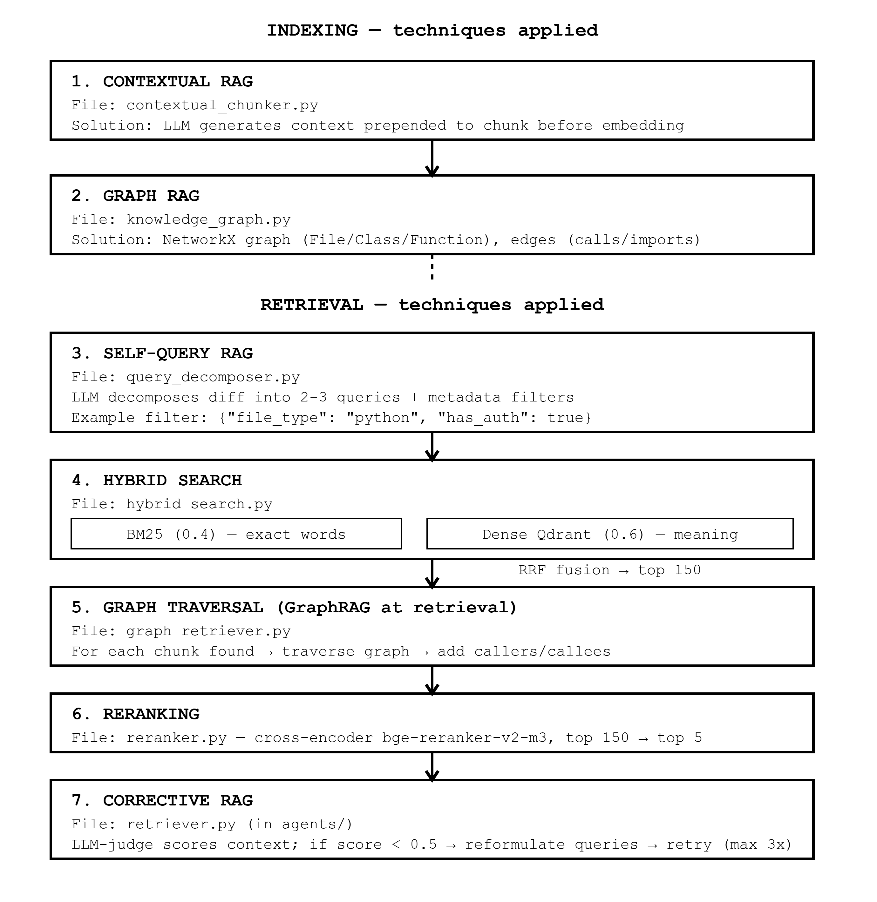
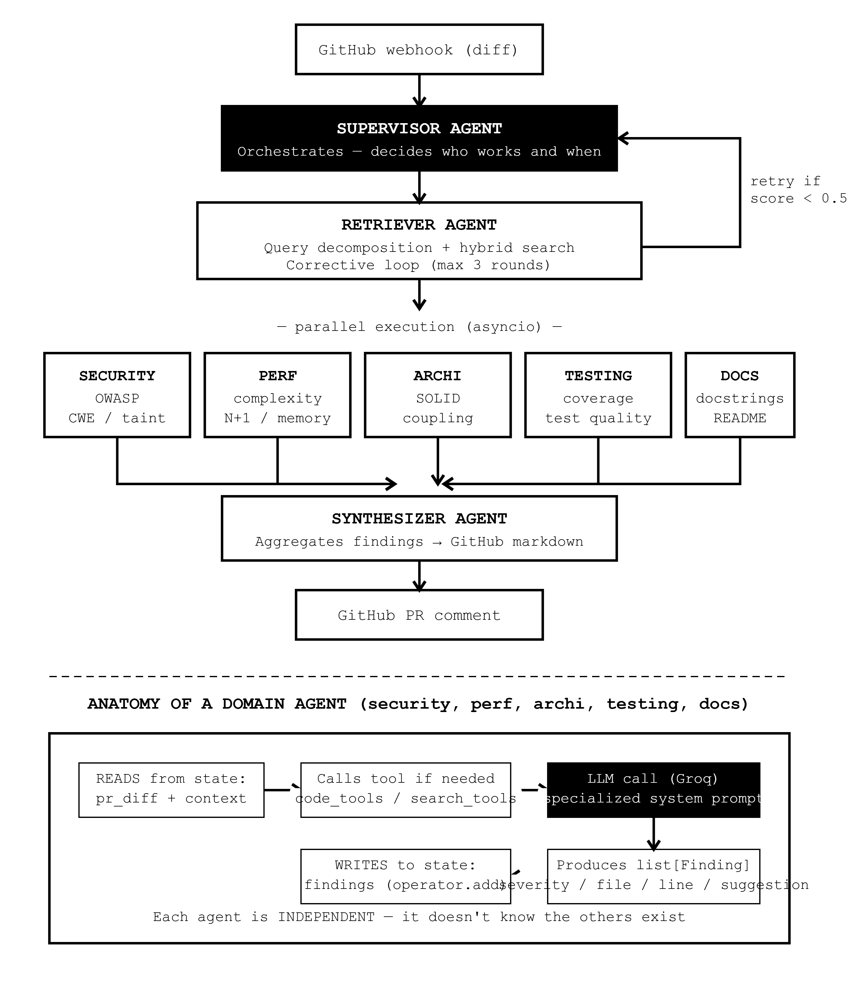

<!--
File purpose: Project overview and onboarding guide for autonomous-code-reviewer.
Inputs: A cloned repository, environment variables from .env, and Docker Compose services.
Outputs: A running local review system accessible through FastAPI and Streamlit.
-->

# autonomous-code-reviewer

An autonomous multi-agent GitHub PR reviewer that uses LangGraph orchestration plus an advanced RAG pipeline to fetch repository context, run specialized security/performance/architecture/testing/documentation analyses in parallel, and post a structured Markdown review back to GitHub.

## Architecture

## Indexing (once)

Repository → Function parsing → Relationship graph → LLM context enrichment → Embeddings → Qdrant

- Parse the codebase into functions/classes.
- Build a dependency graph between components.
- Enrich code chunks with LLM-generated context.
- Generate embeddings and store them in Qdrant.

## Retrieval (per PR)

Diff → Search queries → BM25 + Dense retrieval (Qdrant) → Graph enrichment → Reranking → Top 5 chunks → Quality check → Agents

- Analyze PR changes.
- Retrieve relevant code using hybrid search.
- Enrich results with graph relationships.
- Rerank and select the best context.
- Send validated context to AI agents.

### RAG Retrieval Pipeline



### Multi Agents



```text
GitHub → FastAPI → LangGraph → RAG → GitHub comment
```

## Tech Stack

| Component                | Choice                              |
| ------------------------ | ----------------------------------- |
| LLM                      | Groq (llama-3.3-70b-versatile)      |
| Embeddings               | Voyage AI voyage-code-2             |
| Reranker                 | BAAI/bge-reranker-v2-m3 (local CPU) |
| Graph/orchestration      | LangGraph + LangChain               |
| Retrieval storage (dev)  | ChromaDB                            |
| Retrieval storage (prod) | Qdrant Cloud                        |
| Knowledge graph          | NetworkX (in-memory, persisted)     |
| Backend                  | FastAPI                             |
| Realtime progress        | WebSocket                           |
| DB (persistence)         | PostgreSQL (Render free tier)       |
| Cache                    | Redis (Docker local)                |
| GitHub integration       | PyGithub + Webhooks                 |
| Evaluation               | RAGAS                               |
| Tracing & LLM evaluation | Langfuse (open source)              |
| Dashboard                | Streamlit                           |
| Deploy                   | Railway (Docker-based)              |
| CI/CD                    | GitHub Actions                      |

## Quick Start

1. `git clone` the repository.
2. `cp .env.example .env`
3. Fill in all required keys/URLs.
4. Start services: `docker-compose up --build`
5. Run the API: `uvicorn app.main:app --host 0.0.0.0 --port 8000`

## Quick Start

1. Clone the repository.
2. Copy `.env.example` to `.env` and fill in the required tokens and connection values.
3. Start the stack with `docker-compose up --build`.

The FastAPI service, supporting stores, and the Streamlit dashboard are intended to run together in the same local environment.

```

```
